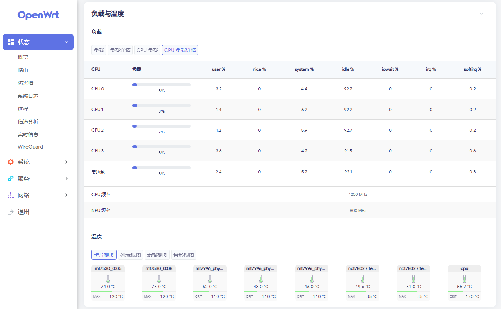

# 负载与温度（luci-app-corestatus）

简体中文 | [English](README.en.md)

一个面向 OpenWrt / LuCI 的状态插件：在状态页显示 CPU 实时负载，自动发现并展示设备上的 GPU、NPU（以及其它加速器）的负载和频率，并展示主板、SoC 与无线模块的温度传感器读数。没有可读负载计数器的硬件只显示频率，不会编造百分比。

插件提供两个入口：

- **状态 → 概览**：概览页里的「负载与温度」组件，每 5 秒刷新，显示 CPU 总负载、各 CPU 负载、GPU/NPU 行，并在下方内嵌温度传感器区块。
- **状态 → 实时信息 → 负载与温度**：CPU 负载与温度曲线页，每 3 秒采样；顶部可在「负载」和「温度」之间切换，分别按 Total/各 CPU 与各传感器分页显示曲线、当前值、平均值、峰值等数据。



## 安装

### 从 Releases 安装

1. 打开 [Releases](https://github.com/Arthur97172/luci-app-corestatus/releases) 页面，下载对应安装包。
2. 把安装包上传到设备（例如 `/tmp`），然后安装：

   **OpenWrt 24.10 及更早（opkg）**

   ```sh
   opkg install /tmp/luci-app-corestatus_*.ipk

   # 可选，安装简体中文语言包：
   opkg install /tmp/luci-i18n-corestatus-zh-cn_*.ipk
   ```

   **OpenWrt 25.12+（apk）**

   ```sh
   apk add --allow-untrusted /tmp/luci-app-corestatus-*.apk

   # 可选，安装简体中文语言包：
   apk add --allow-untrusted /tmp/luci-i18n-corestatus-zh-cn-*.apk
   ```

3. 刷新 LuCI：概览页的「负载与温度」组件下方会出现温度传感器区块，菜单里会出现「状态 → 实时信息 → 负载与温度」，页面内可在负载与温度之间切换。

> 温度功能依赖 `ucode` 与 `ucode-mod-fs`（安装包会自动带上；`rpcd-mod-ucode` 已由 `luci-base` 依赖）。不安装语言包时界面显示英文。包架构为 `all`，纯前端资源，ARM / x86 / MIPS 等平台通用。

### 从源码编译

```sh
cd openwrt
./scripts/feeds update -a
./scripts/feeds install -a
git clone https://github.com/Arthur97172/luci-app-corestatus.git package/luci-app-corestatus
make menuconfig     # LuCI → Applications → luci-app-corestatus
make package/luci-app-corestatus/compile V=s
```

编译产物位于 `bin/packages/<架构>/base/` 目录下，包含插件包和简体中文语言包。

### 直接部署到运行中的设备

不打包，直接用脚本把源码部署到已开启 SSH 的设备（适合开发调试）：

```sh
scripts/deploy-router.sh root@192.168.10.224

# 用密码登录（需要 sshpass，密码通过 SSHPASS 环境变量传入）：
SSHPASS=你的密码 scripts/deploy-router.sh root@192.168.10.224
```

脚本会复制 `root/` 与 `htdocs/`、安装简体中文翻译（需要 `po2lmo`，或用 `PO2LMO="node /path/to/po2lmo.mjs"` 指定编译器）、重启 rpcd、清理 LuCI 缓存并验证结果，可重复执行。

部分厂商固件的概览页使用写死的 include 列表，不会加载第三方应用，脚本会自动检测并给 `/www/luci-static/resources/view/status/index.js` 打补丁（原文件备份为 `/root/luci-mod-status-status-index.js.bak`）；标准 LuCI 会自动发现 include，不打补丁。可用 `--no-overview-patch` 跳过。固件升级会覆盖该补丁，升级后重新运行脚本即可。

## 功能

- **CPU**：读取 `/proc/stat`，计算总负载、各核心负载，以及 user/nice/system/idle/io/irq/sirq 明细；同时显示 CPU 频率。
- **CPU 频率**：优先读取 cpufreq 的当前频率（`scaling_cur_freq` / `cpuinfo_cur_freq`）；内核没有可用的 cpufreq 驱动时（例如 Airoha AN7581），回退到设备树 CPU OPP 表的最高频率。
- **四种概览视图**：负载、负载详情、各 CPU 负载、各 CPU 负载详情；选择结果保存在浏览器本地，下次打开保持。
- **GPU / NPU 自动发现**：启动时扫描，发现硬件才显示对应行；没有 GPU/NPU 的设备只显示 CPU 部分，不出现空行。
- **负载与频率分开呈现**：有负载计数器时画进度条；没有计数器时只显示频率（同类设备有多个时再附带设备名），不显示空进度条或「不可用」。
- **同类设备自动编号**：例如 `GPU 1`、`GPU 2`，并随可用数据分别显示「负载」或「频率」。
- **温度传感器**：读取 hwmon 与 thermal zone，温度区块内嵌在负载与温度组件中，提供卡片、列表、表格、条形四种视图，切换标签与负载的视图标签风格一致；hot/overheat 阈值分别着色。驱动卡住的温度通道只会被探测一次，此后跳过，轮询不会再把内核卡住。
- **标签过多时可左右切换**：实时页的负载与温度标签栏在标签超出一行时，两端会出现 ‹ / › 按钮，逐个切换到上一个/下一个标签并自动滚动到可见区域；标签没有溢出时按钮不显示。
- **只读、无守护进程**：全部数据通过 rpcd 读取，不写 UCI，不启动后台服务。

## 行标签

| 能读取到的数据 | 行标签（中文 / 英文） |
| --- | --- |
| CPU 频率（能读取到频率时） | CPU 频率 / CPU Frequency |
| 负载（无论是否还有频率） | GPU 负载 / GPU Load、NPU 负载 / NPU Load |
| 只有频率 | GPU 频率 / GPU Frequency、NPU 频率 / NPU Frequency |
| 既没有负载也没有频率 | GPU、NPU（只显示名称） |

## 支持的加速器

| 来源 | 典型平台 | 读取内容 |
| --- | --- | --- |
| 标准 devfreq | Rockchip、MediaTek、Allwinner 等多数 ARM SoC | `load`、`gpu_load`、`utilisation`、`utilization`；频率读 `cur_freq` |
| Rockchip rknpu | RK35xx 等带 NPU 的 Rockchip 平台 | debugfs `/sys/kernel/debug/rknpu/load`，多核百分比取平均 |
| Qualcomm Adreno | 高通平台 | kgsl `gpu_busy_percentage` 或 `gpubusy` 的 busy/total |
| NVIDIA Tegra | Tegra 系列 | `/sys/devices/platform/gpu.0/load`（0–1000） |
| AMD GPU | x86 / 部分 ARM 设备 | `/sys/class/drm/card0/device/gpu_busy_percent` |
| Mali kbase / Utgard | 三星、Amlogic 等以 misc 设备暴露的 Mali | `/sys/class/misc/mali0/device/utilization` 与 `clock` |
| misc 形式的厂商 NPU | 以 misc 设备暴露且带计数器的 NPU | `utilization`、`utilisation`、`load`、`gpu_load`、`busy`；频率读 `clock`、`cur_freq`、`frequency` |
| Airoha AN7581 | Airoha/Econet AN7581 等 | NPU 存在性 + debugfs `clk_rate`；无负载计数器，因此显示「NPU 频率」 |

通用 devfreq 与 misc 扫描覆盖大多数把加速器暴露成标准 sysfs 接口的 ARM SoC；使用私有 debugfs/sysfs 接口的平台需要按实际路径继续适配。

解析器同时支持这些负载格式：

- 普通百分比与 `NN %`；
- `busy total` 双计数（自动换算成百分比）；
- 0–1000 的千分比标度；
- Rockchip 的 `12@800000000Hz`；
- Mali 的 `clock` 既可能是 MHz（`600`），也可能是 Hz（`800000000`）。

## 使用方法

### 状态概览

1. 打开「状态 → 概览」，找到「负载与温度」组件。
2. 组件名称下方是「负载」小标题，其下是四个视图切换标签：**负载**、**负载详情**、**各 CPU 负载**、**各 CPU 负载详情**。点击即可切换，选择会保存在浏览器里。
3. 首次加载需要两个采样点才能算出负载，此时数值显示为「计算中...」，约 5 秒后出现结果。
4. CPU 表格下方先显示「CPU 频率」行（能读取到频率时），再显示设备有 GPU/NPU 时对应的行：
   - 有负载计数器：显示进度条、百分比，以及 `设备名 · 频率` 详情；
   - 只有频率：显示「GPU 频率」/「NPU 频率」和频率值（同类设备有多个时附 `设备名 · 频率`），没有进度条；
   - 两类数据都没有：只显示设备名，标签为「GPU」/「NPU」。
5. 没有 GPU/NPU 的设备不会显示这些行；CPU 频率行只要读得到就始终显示。
6. 组件底部的「温度」区块默认以卡片显示每个传感器；上方的**卡片**、**列表**、**表格**、**条形**四个标签可直接切换视图，样式与上方负载的视图标签一致，其中条形视图按过热阈值绘制进度条。视图选择保存在浏览器里。

### 实时状态页

1. 打开「状态 → 实时信息 → 负载与温度」。
2. 页面顶部可在「负载」和「温度」之间切换，选择会保存在浏览器里。
3. 「负载」按 Total 和各 CPU 分页，显示 User、System、Sirq、Total 曲线的当前值、平均值和峰值。
4. 「温度」按传感器分页，显示当前值、最低、平均、峰值以及 hot/overheat 阈值线。
5. 传感器或 CPU 标签较多、超出标签栏宽度时，标签栏左右两端会出现 ‹ / › 按钮：点击切换到上一个/下一个标签，当前标签会自动滚动到可见区域；位于第一个或最后一个标签时对应按钮变灰。标签未溢出时不显示这两个按钮。
6. 两个视图共用同一个 3 秒采样周期，图表窗口覆盖最近几分钟的数据，用来观察短时波动。

## 工作原理

- `view/status/include/18_corestatus.js` 是概览页的 include，LuCI 每 5 秒调用一次 `load()` 并重新渲染；温度区块由 `corestatus/temperature-overview.js` 提供，和负载共用同一次渲染。
- `view/status/corestatus.js` 是实时状态页，组合 `corestatus/load-graph.js` 与 `corestatus/temperature-graph.js`，两者共用一次 3 秒轮询。`corestatus/tab-nav.js` 为这两个页面的标签栏加上左右切换按钮，并在标签溢出时自动滚动当前标签。
- CPU 负载由相邻两次 `/proc/stat` 计数的差值计算，得到的是一段时间内的利用率，而不是开机以来的平均值。
- CPU 频率先读 `/sys/devices/system/cpu/cpu0/cpufreq/scaling_cur_freq`，其次 `cpuinfo_cur_freq`（单位 kHz）。这两个文件不存在时（cpufreq 驱动未注册），改为列出 `/sys/firmware/devicetree/base/opp-table` 下的 `opp-<Hz>` 节点并取最大值；再读不到就不显示该行。
- GPU/NPU 在首次加载时扫描一次并缓存结果；如果结果为空，则最多每分钟重新扫描一次，避免硬件尚未就绪时永久漏掉。
- 所有 sysfs/procfs 读取都通过 rpcd 的 `file` 对象完成，插件在 `acl.d` 里声明允许读取的路径。rpcd 在检查权限前会把符号链接解析成真实路径，因此 ACL 同时放行了 `/sys/class/...` 和解析后的 `/sys/devices/...` 路径。
- 扫描顺序为：先枚举 `/sys/class/devfreq`，再尝试 Rockchip rknpu、Qualcomm kgsl、amdgpu、Tegra、Airoha 等专用接口，最后扫描 `/sys/class/misc`；同一类型已经识别到时，misc 里的重复条目会被忽略。
- 设备类型由名称关键字判断：`npu`、`apu`、`vpu`、`nna`、`ethos` 视为 NPU；`gpu`、`mali`、`panfrost`、`adreno`、`kgsl`、`v3d`、`lima`、`vivante`、`galcore`、`sgpu`、`powervr`、`etnaviv`、`pvr` 视为 GPU。
- 温度数据由随包提供的 rpcd ucode 脚本 `root/usr/share/rpcd/ucode/luci.corestatus` 读取：它向 ubus 注册 `luci.corestatus` 对象，扫描 `/sys/class/hwmon` 与 `/sys/class/thermal`，读取 `tempN_input`、传感器标签和 trip point；驱动报告 `tempN_fault` 非零的输入会被跳过，且 fault 标志先于温度本身读取。hwmon 已覆盖的 thermal zone 会自动去重。
- 读取任何通道之前，先用随包的 `root/usr/libexec/corestatus-temp-probe` 并行读一遍所有 hwmon 温度输入，只保留 2 秒内应答的通道。sysfs 读取一旦卡在驱动里就无法从用户态取消，再次发起会连 rpcd 和它背后的无线驱动一起卡住，所以错过宽限期的通道此后跳过。健康通道列表缓存在 `/tmp/luci.corestatus.tempchannels`；页面发现传感器时，最多每 60 秒对列表里缺的通道重探一次，3–5 秒的轮询本身不再重探（仅在完全没有列表时探测一次）。辅助脚本不可用时完全跳过探测，退回原来的全量读取行为。
- 该脚本运行在 rpcd 进程内，只读，不新增守护进程；由于读取发生在 rpcd 内部，温度 sysfs 路径不需要逐条写入 ACL。
- 插件不写任何配置，也不启动守护进程；卸载后不会留下系统改动。

## 主题与兼容性

- 适配 `luci-theme-bootstrap`（OpenWrt 24.10 / 25.12 默认主题）与 `luci-theme-argon` 2.x / 3.x。
- 明暗主题通过 LuCI 主题变量自适应，无需手动切换。
- 样式只作用于本插件的组件，不影响其它 LuCI 页面。

## 已知限制

- 只能显示内核已经暴露的计数器。完全没有利用率接口的 NPU/GPU（例如 Airoha AN7581 的包转发 NPU）只能显示名称和频率。
- x86 平台的 Intel 核显和 NVIDIA 显卡没有可读的 sysfs 负载节点；AMD 显卡目前只探测 `card0`。这类设备不会出现 GPU 行，CPU 频率与温度仍正常显示。
- CPU 频率读取 cpu0 所属的 cpufreq 策略；大小核（big.LITTLE）设备只显示一个频率值。
- 使用私有 sysfs/debugfs 接口且不在当前探测列表里的平台不会显示，需要补充探测路径、解析器和 ACL 条目。
- rknpu 的负载和 Airoha 的 NPU 频率位于 debugfs。系统未挂载 `/sys/kernel/debug` 时，这些读数会缺失（Airoha 仍能显示名称，只是没有频率）。
- 实时状态页的负载曲线只统计 CPU；GPU/NPU 信息显示在状态概览组件中。温度曲线已并入同一页面，通过「负载 / 温度」切换查看。
- 概览组件的刷新间隔由 LuCI 状态页决定（5 秒），不是独立可配置项。
- 若内核的 cpufreq 驱动没有注册（例如 AN7581 的 CPU 时钟无法报告频率），「CPU 频率」显示的是设备树 OPP 表中的最高频率，而不是实时频率；这类设备本身也没有调频接口。
- 驱动报告 fault 的输入（例如未连接的热敏电阻，读数可能是 127.9 °C 之类的哨兵值）会被跳过；其余明显异常的读数可以结合 hot/overheat 阈值的着色判断是否需要关注。
- 探测时卡住的温度通道会一直隐藏，直到之后某次页面发现传感器时重新探测（最多每 60 秒一次）；卡在内核里的读取本身无法从用户态取消。
- 温度功能需要 `ucode-mod-fs`；极简系统若缺少该模块，温度组件会报告没有可用传感器。
- Argon 2.x 的强制暗色模式通过独立样式表实现，页面上没有可检测的标记，因此插件针对暗色背景的少量补偿只在 Bootstrap 的 `data-darkmode` 下生效；Argon 2.x 自身的明暗样式完整，不影响显示。

## 文件结构

```
.
├── Makefile
├── screenshot.png
├── htdocs/luci-static/resources/
│   ├── svg/temperature.svg
│   ├── svg/corestatus.svg
│   ├── view/status/
│   │   ├── corestatus.js
│   │   └── include/
│   │       └── 18_corestatus.js
│   └── corestatus/
│       ├── load-graph.js
│       ├── tab-nav.js
│       ├── temperature-graph.js
│       └── temperature-overview.js
├── po/templates/corestatus.pot
├── po/zh_Hans/corestatus.po
├── root/
│   ├── usr/libexec/
│   │   └── corestatus-temp-probe
│   └── usr/share/
│       ├── luci/menu.d/luci-app-corestatus.json
│       ├── rpcd/acl.d/luci-app-corestatus.json
│       └── rpcd/ucode/luci.corestatus
├── scripts/
│   ├── check.sh
│   ├── integration-check.js
│   └── integration-check.sh
└── .github/workflows/build.yml
```

## 依赖

- OpenWrt 24.10 或更新版本，带 LuCI（JavaScript 视图，`luci-base`）
- `rpcd` 及 `file` 对象（OpenWrt 自带），用于读取 `/proc/stat` 和 sysfs
- `ucode` 与 `ucode-mod-fs`，用于温度传感器的 RPC；`rpcd-mod-ucode` 由 `luci-base` 依赖
- 简体中文语言包为可选项
- 读取 rknpu 负载或 Airoha NPU 频率时，需要系统已挂载 debugfs

## 开发与检查

仓库自带两层检查，本地和 CI 都会执行：

```sh
scripts/check.sh              # 静态检查：JSON、JS 语法、菜单/ACL 交叉引用、翻译、命名
scripts/integration-check.sh  # 行为测试：用模拟 sysfs 驱动发现、解析和渲染逻辑
```

集成测试用 Node.js 构造各种平台的 sysfs 目录树（Rockchip、Adreno、Tegra、Mali、Airoha 等），不需要真实设备。

CI 在推送到 `main` 后分别用 OpenWrt 24.10 SDK（ipk）和 25.12 SDK（apk）编译，并把两种包和中文语言包发布到 GitHub Release，标签为 `v<PKG_VERSION>`。

## 许可证

GPL-3.0-only。
